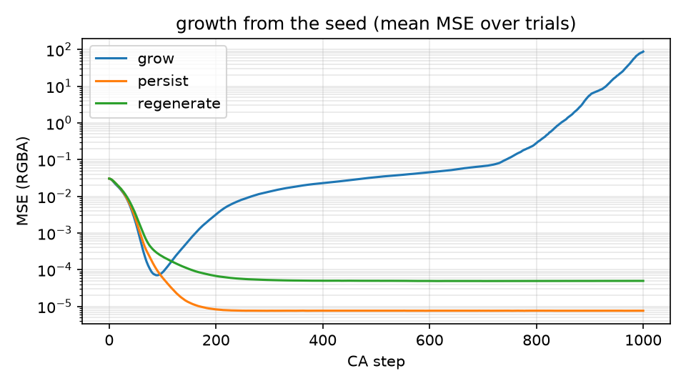
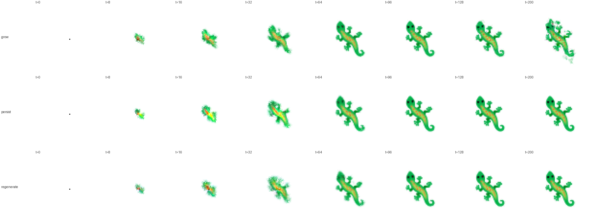
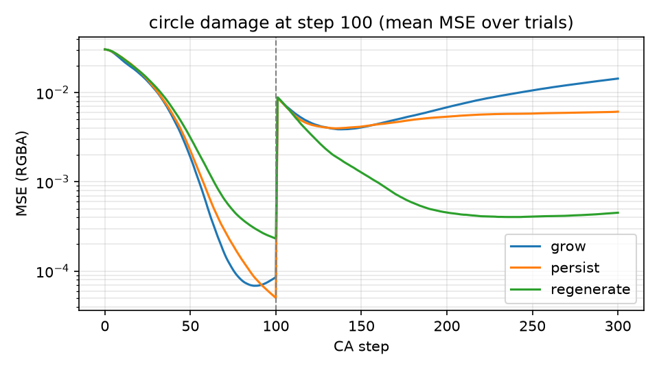
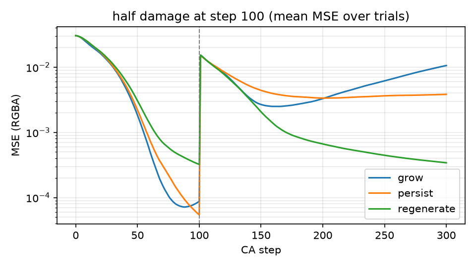
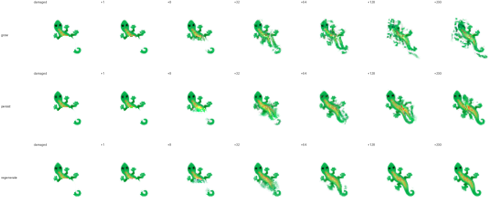
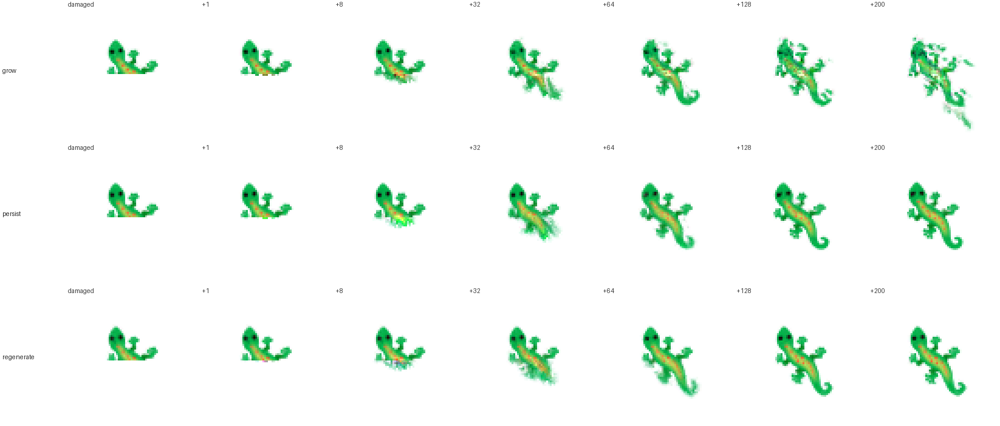

# Results

Lizard target, training seed 0, 20 evaluation trials per trained model. Ablation A (training
regime) and ablation B (update probability) are complete; ablation C (perception) and the other
two training seeds are not run yet.

**In one sentence:** the training regime decides both stability and repair. A rule trained only to
grow loses the pattern after step 100; a rule trained with a sample pool keeps it indefinitely but
repairs it unreliably; a rule that also saw damage during training keeps it and repairs it,
including damage types it never saw.

## Setup

Model and training, identical for the three regimes except the regime itself: 16-channel grid of
72 x 72 cells (40 x 40 Noto lizard with a 16-cell margin), fixed identity / Sobel-x / Sobel-y
perception (48 features per cell), update rule 48 -> 128 -> 16 made of 1 x 1 convolutions with a
ReLU and a zero-initialised output layer, cell update probability 0.5, alive masking at alpha 0.1,
8000 training iterations of batch 8 with 64 to 95 CA steps each, Adam 2e-3 decayed to 2e-4 after
2000 iterations, per-parameter gradient normalisation, MSE on the four RGBA channels.

- `grow`: every batch starts from the single seed cell (Distill experiment 1).
- `persist`: batches are sampled from a pool of 1024 end states and written back after the
  rollout; the worst sample of each batch is reset to the seed (Distill experiment 2).
- `regenerate`: `persist`, plus the three best samples of each batch are damaged with a random
  disc before the rollout (Distill experiment 3).

Evaluation (`nca.evaluate`, 20 trials, seed 0): growth from the seed for 1000 steps, then three
damage types applied at step 100 and followed for 200 steps: a disc of radius 0.3 in [-1, 1] grid
coordinates (about 11 cells) at a random position, half of the grid erased on a random side, or
30 % of the cells zeroed. A trial counts as **recovered** when, at the end of the window, its MSE
is under 0.01 and within 2x the mean MSE of undamaged growths at the same step (never stricter
than 1e-3), and it stayed so until the end; the **recovery time** is the first step of that
sustained return; the **residual ratio** is the MSE at the end of the window divided by the
undamaged control.

## Ablation A: training regime, growth and stability (RQ1)

| run | train loss (last 100 it.) | MSE t=100 | MSE t=500 | MSE t=1000 | training (min) |
|---|---|---|---|---|---|
| grow | 0.000137 | 8.49e-05 | 0.0333 | 88.1 | 20.2 |
| persist | 3.57e-05 | 6.05e-05 | 7.63e-06 | 7.64e-06 | 15.4 |
| regenerate | 0.000252 | 0.000229 | 5e-05 | 4.97e-05 | 15.7 |

- All three rules grow the lizard from one cell in about 90 steps (MSE 6e-5 to 2e-4 at step 100).
- `grow` is a transient: the best match is at step 90, then the pattern keeps growing and decays
  (MSE 3e-3 at step 200, 3e-2 at 500, divergence by 1000). Training only ever showed this rule
  64 to 95 steps of its own dynamics, so nothing constrains what happens afterwards.
- `regenerate` converges to about 5e-5 and stays there until step 1000: the sample pool exposes
  the rule to long trajectories during training and the target becomes an attractor.
- `persist` is the most stable of the three (MSE 8e-6 from step 200 to step 1000): the pool gives it
  the same long-trajectory training as `regenerate` without the damaged samples, so it fits the
  target more tightly (training loss 4e-5 against 2.5e-4).

## Ablation A: training regime, damage recovery (RQ2)

Damage applied at step 100, then 200 steps; 20 trials per condition. The undamaged control is the mean MSE of intact growths at the same step and the residual ratio is the MSE at the end of the window divided by that control. A trial counts as recovered when its MSE is under 0.01 and within 2.0x of the control (floor 0.001) at the end of the window and stayed there; the recovery time is the first step of that sustained return.

| run | damage | MSE after damage | MSE at end of window | undamaged control | residual ratio | recovery rate | mean recovery time (steps) |
|---|---|---|---|---|---|---|---|
| grow | circle | 0.00872 | 0.0143 | 0.0134 | 1.07 | 0.25 | 38 |
| grow | half | 0.0153 | 0.0106 | 0.0134 | 0.788 | 0.50 | 59 |
| grow | dropout | 0.0073 | 0.0108 | 0.0134 | 0.803 | 0.40 | 41 |
| persist | circle | 0.00868 | 0.00612 | 7.62e-06 | 802 | 0.70 | 41 |
| persist | half | 0.0151 | 0.00383 | 7.62e-06 | 502 | 0.25 | 159 |
| persist | dropout | 0.00734 | 0.0045 | 7.62e-06 | 591 | 0.25 | 97 |
| regenerate | circle | 0.00884 | 0.000451 | 5.24e-05 | 8.6 | 0.90 | 41 |
| regenerate | half | 0.0153 | 0.000342 | 5.24e-05 | 6.52 | 0.85 | 68 |
| regenerate | dropout | 0.0074 | 0.000186 | 5.24e-05 | 3.55 | 1.00 | 26 |

- `grow` does regrow a cut half (mean MSE from 1.5e-2 one step after the cut down to 2.5e-3 about
  60 steps later), but the drift then takes over: at the end of the window the damaged runs are
  as bad as the intact control (residual ratio 0.8 to 1.1). Its recovery rates of 0.25 to 0.50
  count the trials whose drift was still under 0.01 at step 300 and should not be read as repair.
- `regenerate` recovers from the disc, the half cut and the dropout in 90 %, 85 % and 100 % of
  the trials, in 41, 68 and 26 steps on average; the MSE at the end of the window (2e-4 to 5e-4)
  is 4 to 9 times the very small intact control. Only disc damage was seen during training: the
  half cut and the dropout are new damage types and the rule handles them.
- `persist` shows that stability does not imply repair: it recovers from the disc in 70 % of the
  trials but from the half cut and the dropout in only 25 %, and the trials that do recover from
  the half cut need 159 steps on average (68 for `regenerate`). Its MSE at the end of the window
  (4e-3 to 6e-3) is 500 to 800 times its intact control; in the failed trials the missing tissue
  regrows with the wrong shape (extra or misplaced limbs and tail, see the disc strips).

## Ablation B: update probability (RQ2)

Same `regenerate` training with the cell update probability p set to 1.0 (every cell updates at
every step, i.e. a synchronous automaton), 0.5 (the baseline above) and 0.25. Same evaluation
protocol. A cell updates on average every 1/p steps, so recovery times in CA steps are not
directly comparable across rows.

| run | train loss (last 100 it.) | MSE t=100 | MSE t=500 | MSE t=1000 | training (min) |
|---|---|---|---|---|---|
| p = 1.0 | 8.54e-05 | 3.17e-05 | 2.11e-05 | 2.12e-05 | 15.1 |
| p = 0.5 | 0.000252 | 0.000229 | 5e-05 | 4.97e-05 | 15.7 |
| p = 0.25 | 0.00079 | 0.00119 | 0.000101 | 8.59e-05 | 15.0 |

| run | damage | MSE after damage | MSE at end of window | undamaged control | residual ratio | recovery rate | mean recovery time (steps) |
|---|---|---|---|---|---|---|---|
| p = 1.0 | circle | 0.00847 | 2.47e-05 | 2.09e-05 | 1.18 | 1.00 | 32 |
| p = 1.0 | half | 0.0147 | 0.00181 | 2.09e-05 | 86.7 | 0.55 | 49 |
| p = 1.0 | dropout | 0.00646 | 5.61e-05 | 2.09e-05 | 2.68 | 1.00 | 30 |
| p = 0.5 | circle | 0.00884 | 0.000451 | 5.24e-05 | 8.6 | 0.90 | 41 |
| p = 0.5 | half | 0.0153 | 0.000342 | 5.24e-05 | 6.52 | 0.85 | 68 |
| p = 0.5 | dropout | 0.0074 | 0.000186 | 5.24e-05 | 3.55 | 1.00 | 26 |
| p = 0.25 | circle | 0.00982 | 0.000857 | 0.000138 | 6.23 | 0.75 | 56 |
| p = 0.25 | half | 0.016 | 0.000666 | 0.000138 | 4.85 | 0.90 | 124 |
| p = 0.25 | dropout | 0.00905 | 0.000256 | 0.000138 | 1.86 | 1.00 | 61 |

- Growth speed scales with p: the MSE at step 100 is 3e-5, 2e-4 and 1.2e-3 for p = 1.0, 0.5 and
  0.25, and the p = 0.25 rule only reaches 2e-4 at step 200. All three are stable until step
  1000 (2e-5 to 9e-5).
- p = 1.0 fits the target best (training loss 8.5e-5) and repairs the disc and the dropout in
  every trial in about 30 steps, but recovers from the half cut in only 55 % of the trials: the
  mean curve plateaus near 2e-3 after step 170, where the failed trials stall. The synchronous
  rule loses robustness exactly on the largest damage.
- p = 0.25 recovers from the half cut in 90 % of the trials but needs 124 steps (about 31
  updates per cell), and its disc recovery (0.75) is measured on a pattern that was still
  converging when the damage hit at step 100 (pre-damage MSE 1.3e-3).
- The baseline p = 0.5 is the best compromise on this seed: fast growth and 0.85 to 1.00
  recovery on the three damage types. Asynchronous updates cost speed but buy robustness,
  which is the argument Mordvintsev et al. give for the stochastic update.

## Caveats

- One training seed per condition so far; the 20 trials share the same model, so the spread they
  show comes from the stochastic update and the damage placement, not from training variance.
- The absolute threshold (MSE 0.01, a root-mean-square error of 0.1 per RGBA channel) corresponds
  to visible defects; the 1e-3 floor keeps the relative test from penalising near-perfect runs
  whose control is around 1e-5 to 5e-5.
- Damage is applied at step 100 only; the `regenerate` model was trained with discs of radius
  0.1 to 0.4 and is tested at 0.3.

## Next steps

Two more training seeds per condition; ablation C (Sobel + Laplacian, learned 3 x 3 kernels) on
the `regenerate` regime; a second target.

## Files

- `results/<run>/`: `config.json`, `summary.json`, `loss.png`, `growth_strip.png` and `eval/`
  (`metrics.json`, `curves.npz`, one curve and one strip per damage type).
- `results/ablation_A_regime/`, `results/ablation_B_fire_rate/`: `comparison.md` (the tables above)
  and the overlaid figures of each ablation.
