# Results

Lizard target, three training seeds (0, 1, 2) per condition, 20 evaluation trials per trained
model. Ablations A (training regime), B (update probability) and C (perception) are complete. The
three ablation sections analyse seed 0 in detail (per-run tables, curves and strips); the section
"Three training seeds" pools the seeds and gives the headline numbers with their seed-to-seed
range.

**In one sentence:** the training regime decides both stability and repair, on every seed. A rule
trained only to grow loses the pattern after step 100; a rule trained with a sample pool keeps it
indefinitely but repairs it unreliably (half cut 0.22, dropout 0.08 over three seeds); a rule that
also saw damage during training keeps it and repairs it, including damage types it never saw
(0.88 / 0.90 / 0.98). Within the `regenerate` regime, the update probability matters more than the
perception kernels: synchronous updates (p = 1.0) make half-cut repair unreliable on two seeds out
of three and p = 0.25 is slower and less reliable on every damage type, while the three perceptions
all repair, the Sobel + Laplacian stage being the best by a small but consistent margin.

## Setup

Model and training, identical for the three regimes except the regime itself: 16-channel grid of
72 x 72 cells (40 x 40 Noto lizard with a 16-cell margin), fixed identity / Sobel-x / Sobel-y
perception (48 features per cell), update rule 48 -> 128 -> 16 made of 1 x 1 convolutions with a
ReLU and a zero-initialised output layer, cell update probability 0.5, alive masking at alpha 0.1,
8000 training iterations of batch 8 with 64 to 95 CA steps each, Adam 2e-3 decayed to 2e-4 after
2000 iterations, per-parameter gradient normalisation, MSE on the four RGBA channels.

- `grow`: every batch starts from the single seed cell (Distill experiment 1).
- `persist`: batches are sampled from a pool of 1024 end states and written back after the
  rollout; the worst sample of each batch is reset to the seed (Distill experiment 2).
- `regenerate`: `persist`, plus the three best samples of each batch are damaged with a random
  disc before the rollout (Distill experiment 3).

Evaluation (`nca.evaluate`, 20 trials, seed 0): growth from the seed for 1000 steps, then three
damage types applied at step 100 and followed for 200 steps: a disc of radius 0.3 in [-1, 1] grid
coordinates (about 11 cells) at a random position, half of the grid erased on a random side, or
30 % of the cells zeroed. A trial counts as **recovered** when, at the end of the window, its MSE
is under 0.01 and within 2x the mean MSE of undamaged growths at the same step (never stricter
than 1e-3), and it stayed so until the end; the **recovery time** is the first step of that
sustained return; the **residual ratio** is the MSE at the end of the window divided by the
undamaged control.

## Ablation A (seed 0): training regime, growth and stability (RQ1)

| run | train loss (last 100 it.) | MSE t=100 | MSE t=500 | MSE t=1000 | training (min) |
|---|---|---|---|---|---|
| grow | 0.000137 | 8.49e-05 | 0.0333 | 88.1 | 20.2 |
| persist | 3.57e-05 | 6.05e-05 | 7.63e-06 | 7.64e-06 | 15.4 |
| regenerate | 0.000252 | 0.000229 | 5e-05 | 4.97e-05 | 15.7 |

- All three rules grow the lizard from one cell in about 90 steps (MSE 6e-5 to 2e-4 at step 100).
- `grow` is a transient: the best match is at step 90, then the pattern keeps growing and decays
  (MSE 3e-3 at step 200, 3e-2 at 500, divergence by 1000). Training only ever showed this rule
  64 to 95 steps of its own dynamics, so nothing constrains what happens afterwards.
- `regenerate` converges to about 5e-5 and stays there until step 1000: the sample pool exposes
  the rule to long trajectories during training and the target becomes an attractor.
- `persist` is the most stable of the three (MSE 8e-6 from step 200 to step 1000): the pool gives it
  the same long-trajectory training as `regenerate` without the damaged samples, so it fits the
  target more tightly (training loss 4e-5 against 2.5e-4).

## Ablation A (seed 0): training regime, damage recovery (RQ2)

Damage applied at step 100, then 200 steps; 20 trials per condition. The undamaged control is the mean MSE of intact growths at the same step and the residual ratio is the MSE at the end of the window divided by that control. A trial counts as recovered when its MSE is under 0.01 and within 2.0x of the control (floor 0.001) at the end of the window and stayed there; the recovery time is the first step of that sustained return.

| run | damage | MSE after damage | MSE at end of window | undamaged control | residual ratio | recovery rate | mean recovery time (steps) |
|---|---|---|---|---|---|---|---|
| grow | circle | 0.00872 | 0.0143 | 0.0134 | 1.07 | 0.25 | 38 |
| grow | half | 0.0153 | 0.0106 | 0.0134 | 0.788 | 0.50 | 59 |
| grow | dropout | 0.0073 | 0.0108 | 0.0134 | 0.803 | 0.40 | 41 |
| persist | circle | 0.00868 | 0.00612 | 7.62e-06 | 802 | 0.70 | 41 |
| persist | half | 0.0151 | 0.00383 | 7.62e-06 | 502 | 0.25 | 159 |
| persist | dropout | 0.00734 | 0.0045 | 7.62e-06 | 591 | 0.25 | 97 |
| regenerate | circle | 0.00884 | 0.000451 | 5.24e-05 | 8.6 | 0.90 | 41 |
| regenerate | half | 0.0153 | 0.000342 | 5.24e-05 | 6.52 | 0.85 | 68 |
| regenerate | dropout | 0.0074 | 0.000186 | 5.24e-05 | 3.55 | 1.00 | 26 |

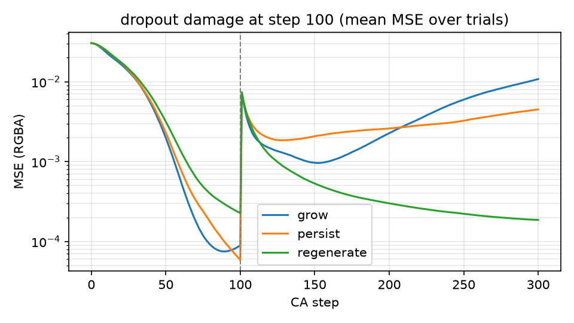

- `grow` does regrow a cut half (mean MSE from 1.5e-2 one step after the cut down to 2.5e-3 about
  60 steps later), but the drift then takes over: at the end of the window the damaged runs are
  as bad as the intact control (residual ratio 0.8 to 1.1). Its recovery rates of 0.25 to 0.50
  count the trials whose drift was still under 0.01 at step 300 and should not be read as repair.
- `regenerate` recovers from the disc, the half cut and the dropout in 90 %, 85 % and 100 % of
  the trials, in 41, 68 and 26 steps on average; the MSE at the end of the window (2e-4 to 5e-4)
  is 4 to 9 times the very small intact control. Only disc damage was seen during training: the
  half cut and the dropout are new damage types and the rule handles them.
- `persist` shows that stability does not imply repair: it recovers from the disc in 70 % of the
  trials but from the half cut and the dropout in only 25 %, and the trials that do recover from
  the half cut need 159 steps on average (68 for `regenerate`). Its MSE at the end of the window
  (4e-3 to 6e-3) is 500 to 800 times its intact control; in the failed trials the missing tissue
  regrows with the wrong shape (extra or misplaced limbs and tail, see the disc strips).

## Ablation B (seed 0): update probability (RQ2)

Same `regenerate` training with the cell update probability p set to 1.0 (every cell updates at
every step, i.e. a synchronous automaton), 0.5 (the baseline above) and 0.25. Same evaluation
protocol. A cell updates on average every 1/p steps, so recovery times in CA steps are not
directly comparable across rows.

| run | train loss (last 100 it.) | MSE t=100 | MSE t=500 | MSE t=1000 | training (min) |
|---|---|---|---|---|---|
| p = 1.0 | 8.54e-05 | 3.17e-05 | 2.11e-05 | 2.12e-05 | 15.1 |
| p = 0.5 | 0.000252 | 0.000229 | 5e-05 | 4.97e-05 | 15.7 |
| p = 0.25 | 0.00079 | 0.00119 | 0.000101 | 8.59e-05 | 15.0 |

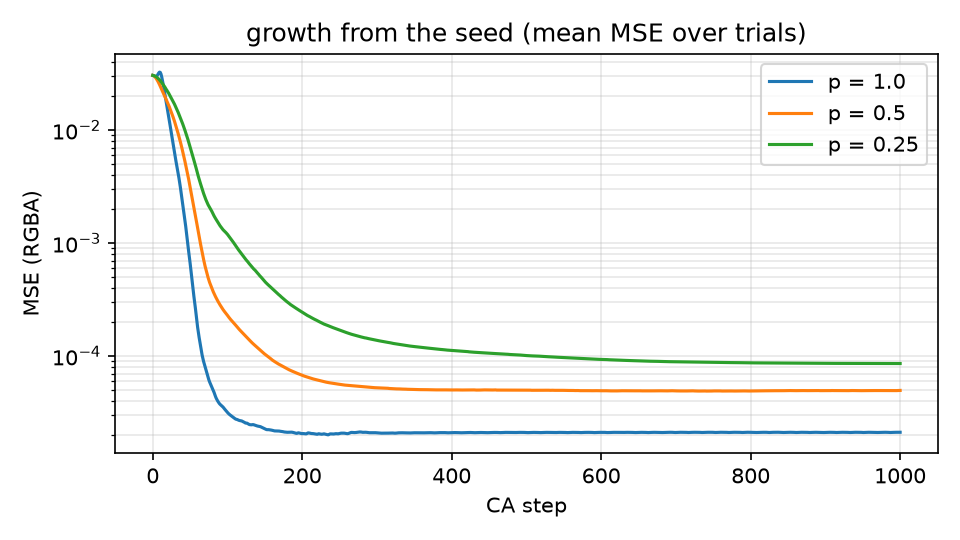

| run | damage | MSE after damage | MSE at end of window | undamaged control | residual ratio | recovery rate | mean recovery time (steps) |
|---|---|---|---|---|---|---|---|
| p = 1.0 | circle | 0.00847 | 2.47e-05 | 2.09e-05 | 1.18 | 1.00 | 32 |
| p = 1.0 | half | 0.0147 | 0.00181 | 2.09e-05 | 86.7 | 0.55 | 49 |
| p = 1.0 | dropout | 0.00646 | 5.61e-05 | 2.09e-05 | 2.68 | 1.00 | 30 |
| p = 0.5 | circle | 0.00884 | 0.000451 | 5.24e-05 | 8.6 | 0.90 | 41 |
| p = 0.5 | half | 0.0153 | 0.000342 | 5.24e-05 | 6.52 | 0.85 | 68 |
| p = 0.5 | dropout | 0.0074 | 0.000186 | 5.24e-05 | 3.55 | 1.00 | 26 |
| p = 0.25 | circle | 0.00982 | 0.000857 | 0.000138 | 6.23 | 0.75 | 56 |
| p = 0.25 | half | 0.016 | 0.000666 | 0.000138 | 4.85 | 0.90 | 124 |
| p = 0.25 | dropout | 0.00905 | 0.000256 | 0.000138 | 1.86 | 1.00 | 61 |

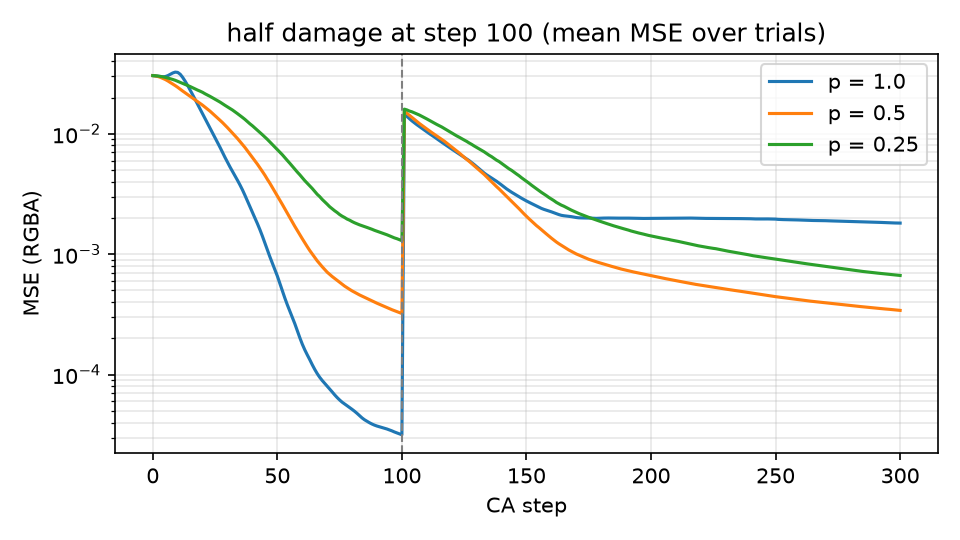

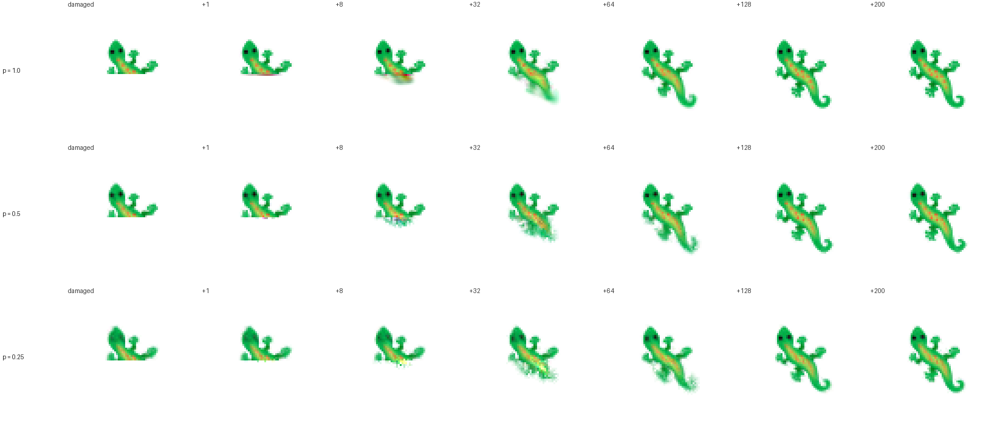

- Growth speed scales with p: the MSE at step 100 is 3e-5, 2e-4 and 1.2e-3 for p = 1.0, 0.5 and
  0.25, and the p = 0.25 rule only reaches 2e-4 at step 200. All three are stable until step
  1000 (2e-5 to 9e-5).
- p = 1.0 fits the target best (training loss 8.5e-5) and repairs the disc and the dropout in
  every trial in about 30 steps, but recovers from the half cut in only 55 % of the trials: the
  mean curve plateaus near 2e-3 after step 170, where the failed trials stall. The synchronous
  rule loses robustness exactly on the largest damage.
- p = 0.25 recovers from the half cut in 90 % of the trials but needs 124 steps (about 31
  updates per cell), and its disc recovery (0.75) is measured on a pattern that was still
  converging when the damage hit at step 100 (pre-damage MSE 1.3e-3).
- The baseline p = 0.5 is the best compromise on this seed: fast growth and 0.85 to 1.00
  recovery on the three damage types. Asynchronous updates cost speed but buy robustness,
  which is the argument Mordvintsev et al. give for the stochastic update.

## Ablation C (seed 0): perception (RQ2)

Same `regenerate` training (p = 0.5) with three perception stages: the fixed identity / Sobel-x /
Sobel-y kernels (48 features per cell, 8320 parameters, the baseline above), the same plus a fixed
3 x 3 Laplacian (64 features, 10368 parameters), and the three baseline kernels initialised as
above but trained together with the rest of the rule (8752 parameters).

| run | train loss (last 100 it.) | MSE t=100 | MSE t=500 | MSE t=1000 | training (min) |
|---|---|---|---|---|---|
| sobel | 0.000252 | 0.000229 | 5e-05 | 4.97e-05 | 15.7 |
| sobel + laplacian | 0.000103 | 4.91e-05 | 1.46e-05 | 1.46e-05 | 15.3 |
| learned | 0.000117 | 0.000103 | 3.33e-05 | 3.36e-05 | 15.4 |

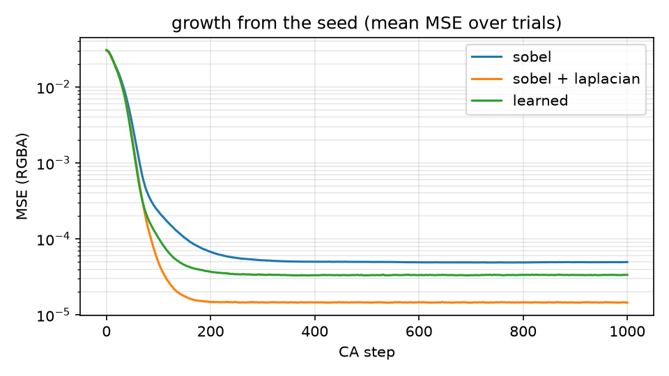

| run | damage | MSE after damage | MSE at end of window | undamaged control | residual ratio | recovery rate | mean recovery time (steps) |
|---|---|---|---|---|---|---|---|
| sobel | circle | 0.00884 | 0.000451 | 5.24e-05 | 8.6 | 0.90 | 41 |
| sobel | half | 0.0153 | 0.000342 | 5.24e-05 | 6.52 | 0.85 | 68 |
| sobel | dropout | 0.0074 | 0.000186 | 5.24e-05 | 3.55 | 1.00 | 26 |
| sobel + laplacian | circle | 0.0086 | 0.000186 | 1.47e-05 | 12.6 | 0.95 | 32 |
| sobel + laplacian | half | 0.015 | 0.000737 | 1.47e-05 | 50.1 | 0.80 | 49 |
| sobel + laplacian | dropout | 0.00682 | 1.55e-05 | 1.47e-05 | 1.05 | 1.00 | 14 |
| learned | circle | 0.00871 | 0.000188 | 3.38e-05 | 5.55 | 0.95 | 36 |
| learned | half | 0.0151 | 0.000463 | 3.38e-05 | 13.7 | 0.95 | 70 |
| learned | dropout | 0.0069 | 0.000176 | 3.38e-05 | 5.21 | 0.95 | 18 |

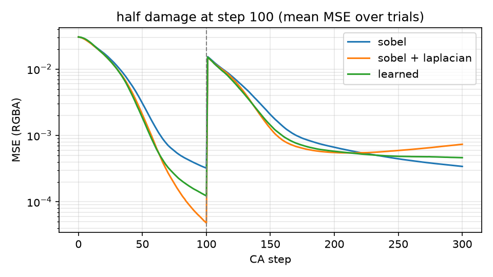

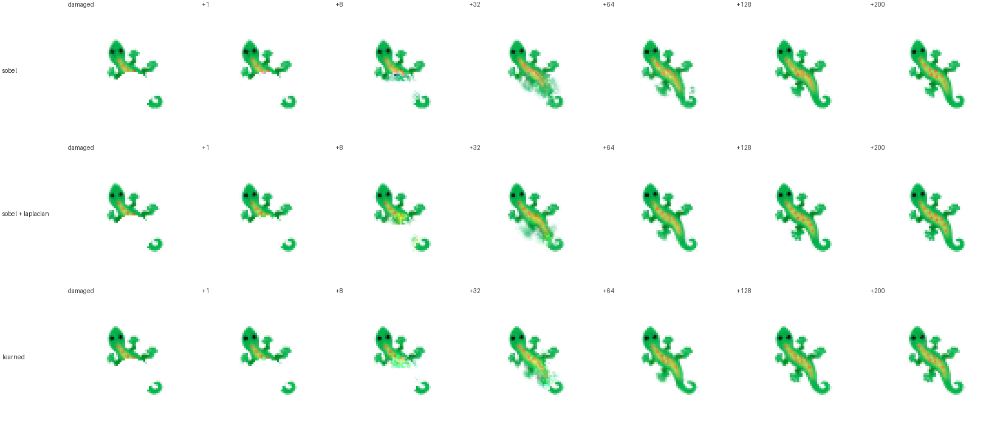

- All three perceptions give stable rules (1.5e-5 to 5e-5 at step 1000) that repair the three
  damage types in 80 to 100 % of the trials. With 20 trials one trial is 5 %, so the rate
  differences between perceptions are within the resolution of this single-seed experiment:
  the perception matters less than the training regime (ablation A) or the update probability
  (ablation B).
- The Laplacian channel gives the best fit (training loss 1.0e-4, MSE 5e-5 at step 100 against
  2.3e-4 for the baseline) and the fastest repairs (32, 49 and 14 steps; the dropout is repaired
  back to the quality of the intact control, residual ratio 1.05). Its half-cut rate (0.80) is
  the lowest of the three but one trial away from the baseline, and its mean half-cut curve
  rises again after step 220: the few trials that regrew the wrong shape keep drifting.
- Learning the kernels instead of fixing them changes little (training loss 1.2e-4, recovery
  0.95 on each damage type, similar recovery times): the fixed Sobel filters are already an
  adequate perception for this task, which supports the choice made by Mordvintsev et al.

## Three training seeds (ablations A, B and C pooled)

The seven conditions above (three regimes, two more update probabilities, two more perceptions)
were retrained with seeds 1 and 2 (`scripts/run_ablations.py --seeds 1 2`, 14 runs, 3 h 14 min of
GPU in total) and evaluated with the same protocol and the same evaluation seed, so every model
meets the same damage positions and dropout masks. In the tables each cell is the mean over the
three seeds with the [min, max] range (`scripts/compare_runs.py --by-condition`); a recovery rate
is therefore pooled over 3 x 20 trials, and a difference smaller than the range of either
condition should not be read. In the figures the curves average the 60 trials and the shaded band
spans the three per-seed means.

### Training regime (ablation A)

| condition | seeds | train loss (last 100 it.) | MSE t=100 | MSE t=500 | MSE t=1000 |
|---|---|---|---|---|---|
| grow | 3 | 0.000168 [0.000137, 0.000208] | 0.000119 [8.49e-05, 0.000166] | 0.0278 [0.0218, 0.0333] | 29.4 [0.068, 88.1] |
| persist | 3 | 4.19e-05 [3.57e-05, 4.99e-05] | 8.09e-05 [6.05e-05, 0.000103] | 1.07e-05 [7.63e-06, 1.33e-05] | 1.08e-05 [7.64e-06, 1.33e-05] |
| regenerate | 3 | 0.000236 [0.000228, 0.000252] | 0.000192 [0.000167, 0.000229] | 4.01e-05 [2.62e-05, 5e-05] | 4e-05 [2.61e-05, 4.97e-05] |

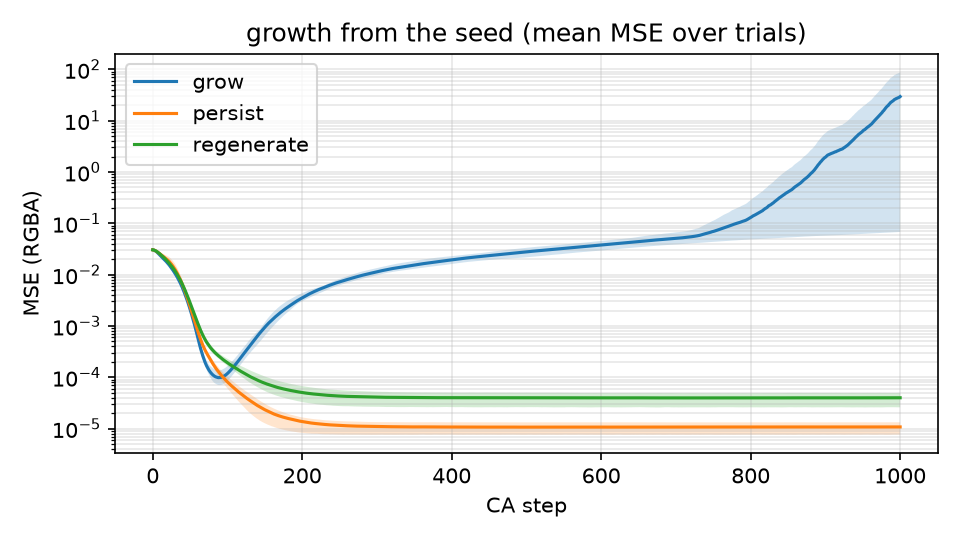

| condition | damage | seeds | MSE at end of window | residual ratio | recovery rate | mean recovery time (steps) |
|---|---|---|---|---|---|---|
| grow | circle | 3 | 0.0128 [0.0118, 0.0143] | 1.13 [1.07, 1.24] | 0.48 [0.25, 0.65] | 32 [26, 38] |
| grow | half | 3 | 0.00991 [0.0093, 0.0106] | 0.88 [0.788, 0.954] | 0.58 [0.50, 0.65] | 54 [52, 59] |
| grow | dropout | 3 | 0.00985 [0.0081, 0.0108] | 0.869 [0.803, 0.973] | 0.60 [0.40, 0.85] | 39 [39, 41] |
| persist | circle | 3 | 0.00833 [0.00612, 0.0104] | 770 [633, 875] | 0.57 [0.40, 0.70] | 42 [36, 47] |
| persist | half | 3 | 0.00751 [0.00383, 0.0124] | 672 [466, 1.05e+03] | 0.22 [0.00, 0.40] | 154 [148, 159] |
| persist | dropout | 3 | 0.00754 [0.0045, 0.00958] | 674 [591, 720] | 0.08 [0.00, 0.25] | 97 |
| regenerate | circle | 3 | 0.000413 [0.000354, 0.000451] | 10.6 [8.6, 13.3] | 0.88 [0.85, 0.90] | 39 [38, 41] |
| regenerate | half | 3 | 0.000272 [9.12e-05, 0.000383] | 6.2 [3.42, 8.66] | 0.90 [0.85, 1.00] | 67 [61, 71] |
| regenerate | dropout | 3 | 0.000118 [7.11e-05, 0.000186] | 2.93 [1.61, 3.63] | 0.98 [0.95, 1.00] | 24 [20, 26] |

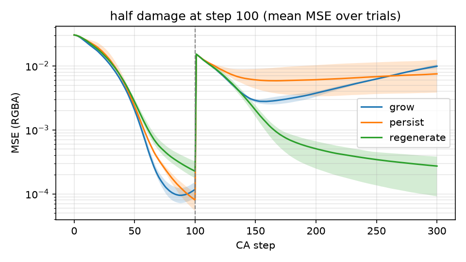

- The ordering of the seed-0 sections holds on every seed. `grow` drifts after its best match near
  step 90 on all three seeds (MSE 2e-2 to 3e-2 at step 500; one seed diverges to 88 by step 1000,
  the other two reach 0.07 and 0.1), `persist` is the most stable (1.1e-5 at step 1000, range
  7.6e-6 to 1.3e-5) and `regenerate` converges to 4e-5 (2.6e-5 to 5e-5).
- `regenerate` is also the most consistent at repair: 0.88 [0.85, 0.90], 0.90 [0.85, 1.00] and
  0.98 [0.95, 1.00] on the disc, the half cut and the dropout, in 39, 67 and 24 steps; the
  seed-to-seed range never exceeds 0.15.
- `persist` repairs even less than seed 0 suggested: 0.57 on the disc but 0.22 [0.00, 0.40] on
  the half cut and 0.08 [0.00, 0.25] on the dropout (seed 2 recovers neither in a single trial and
  only seed 0 ever recovers from the dropout), with a residual ratio of 670 to 770. Its band in
  the half-cut figure stays between 4e-3 and 1.2e-2 for the whole window.
- The rates of `grow` (0.48 to 0.60) remain an artefact of the drift: its residual ratio is 0.87
  to 1.13 on every damage type, i.e. the damaged runs end exactly as bad as the intact ones.

### Update probability (ablation B)

| condition | seeds | train loss (last 100 it.) | MSE t=100 | MSE t=500 | MSE t=1000 |
|---|---|---|---|---|---|
| p = 1.0 | 3 | 8.29e-05 [6.38e-05, 9.96e-05] | 2.95e-05 [2.09e-05, 3.6e-05] | 2e-05 [1.42e-05, 2.47e-05] | 2e-05 [1.42e-05, 2.47e-05] |
| p = 0.5 | 3 | 0.000236 [0.000228, 0.000252] | 0.000192 [0.000167, 0.000229] | 4.01e-05 [2.62e-05, 5e-05] | 4e-05 [2.61e-05, 4.97e-05] |
| p = 0.25 | 3 | 0.000821 [0.00071, 0.000963] | 0.00125 [0.00114, 0.00142] | 0.000142 [0.000101, 0.000216] | 0.000148 [8.59e-05, 0.000256] |

| condition | damage | seeds | MSE at end of window | residual ratio | recovery rate | mean recovery time (steps) |
|---|---|---|---|---|---|---|
| p = 1.0 | circle | 3 | 3.78e-05 [2.47e-05, 4.74e-05] | 2.06 [1.18, 3.32] | 1.00 [1.00, 1.00] | 32 [32, 32] |
| p = 1.0 | half | 3 | 0.00161 [9.52e-05, 0.00291] | 70.6 [6.67, 118] | 0.70 [0.55, 1.00] | 57 [49, 63] |
| p = 1.0 | dropout | 3 | 3.45e-05 [1.62e-05, 5.61e-05] | 1.69 [1.13, 2.68] | 1.00 [1.00, 1.00] | 24 [21, 30] |
| p = 0.5 | circle | 3 | 0.000413 [0.000354, 0.000451] | 10.6 [8.6, 13.3] | 0.88 [0.85, 0.90] | 39 [38, 41] |
| p = 0.5 | half | 3 | 0.000272 [9.12e-05, 0.000383] | 6.2 [3.42, 8.66] | 0.90 [0.85, 1.00] | 67 [61, 71] |
| p = 0.5 | dropout | 3 | 0.000118 [7.11e-05, 0.000186] | 2.93 [1.61, 3.63] | 0.98 [0.95, 1.00] | 24 [20, 26] |
| p = 0.25 | circle | 3 | 0.00139 [0.000857, 0.00166] | 6.87 [5.03, 9.36] | 0.70 [0.60, 0.75] | 52 [48, 56] |
| p = 0.25 | half | 3 | 0.000888 [0.000666, 0.00128] | 4.26 [3.86, 4.85] | 0.68 [0.40, 0.90] | 119 [113, 124] |
| p = 0.25 | dropout | 3 | 0.000457 [0.000256, 0.000712] | 2.1 [1.86, 2.27] | 0.92 [0.80, 1.00] | 57 [47, 61] |

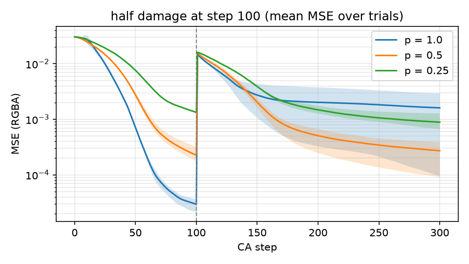

- p = 1.0 fits and grows best on every seed (training loss 8e-5, MSE 3e-5 at step 100 and 2e-5 at
  step 1000) and repairs the disc and the dropout in every trial of every seed, but its half-cut
  rate is 0.70 [0.55, 1.00]: seeds 0 and 2 stall at 0.55 while seed 1 repairs all 20 trials. The
  wide band of its mean curve (1e-4 to 3e-3 at the end of the window) is this seed dependence. The
  fragility of the synchronous rule on the largest damage is confirmed on two seeds out of three,
  and the third shows that it is not systematic.
- p = 0.25 is the least reliable setting once the seeds are pooled: 0.70 [0.60, 0.75], 0.68
  [0.40, 0.90] and 0.92 [0.80, 1.00], with recovery times of 52, 119 and 57 steps; the half-cut
  rate of 0.90 reported for seed 0 was the best of its three seeds (0.40 for seed 2). It is also
  the least stable (1.5e-4 at step 1000, up to 2.6e-4) and still 1.2e-3 away from the target when
  the damage hits at step 100.
- p = 0.5 keeps the best balance: the highest pooled half-cut rate (0.90), 0.88 and 0.98 on the
  other two damage types, and no range wider than 0.15. Across seeds the update probability is the
  setting with the largest effect inside the `regenerate` regime.

### Perception (ablation C)

| condition | seeds | train loss (last 100 it.) | MSE t=100 | MSE t=500 | MSE t=1000 |
|---|---|---|---|---|---|
| regenerate | 3 | 0.000236 [0.000228, 0.000252] | 0.000192 [0.000167, 0.000229] | 4.01e-05 [2.62e-05, 5e-05] | 4e-05 [2.61e-05, 4.97e-05] |
| regenerate (sobel_lap) | 3 | 8.36e-05 [7.31e-05, 0.000103] | 3.91e-05 [3.38e-05, 4.91e-05] | 1.24e-05 [9.65e-06, 1.46e-05] | 1.23e-05 [9.65e-06, 1.46e-05] |
| regenerate (learned) | 3 | 0.000112 [0.000104, 0.000117] | 7.94e-05 [5.54e-05, 0.000103] | 2.62e-05 [1.7e-05, 3.33e-05] | 2.62e-05 [1.7e-05, 3.36e-05] |

| condition | damage | seeds | MSE at end of window | residual ratio | recovery rate | mean recovery time (steps) |
|---|---|---|---|---|---|---|
| regenerate | circle | 3 | 0.000413 [0.000354, 0.000451] | 10.6 [8.6, 13.3] | 0.88 [0.85, 0.90] | 39 [38, 41] |
| regenerate | half | 3 | 0.000272 [9.12e-05, 0.000383] | 6.2 [3.42, 8.66] | 0.90 [0.85, 1.00] | 67 [61, 71] |
| regenerate | dropout | 3 | 0.000118 [7.11e-05, 0.000186] | 2.93 [1.61, 3.63] | 0.98 [0.95, 1.00] | 24 [20, 26] |
| regenerate (sobel_lap) | circle | 3 | 7.04e-05 [1.05e-05, 0.000186] | 4.96 [1.08, 12.6] | 0.98 [0.95, 1.00] | 33 [32, 34] |
| regenerate (sobel_lap) | half | 3 | 0.000254 [1.04e-05, 0.000737] | 17.4 [1.07, 50.1] | 0.93 [0.80, 1.00] | 49 [49, 50] |
| regenerate (sobel_lap) | dropout | 3 | 1.29e-05 [1.01e-05, 1.55e-05] | 1.04 [1.01, 1.05] | 1.00 [1.00, 1.00] | 12 [10, 14] |
| regenerate (learned) | circle | 3 | 0.000298 [0.000188, 0.000488] | 11.7 [5.55, 16.5] | 0.92 [0.85, 0.95] | 34 [28, 36] |
| regenerate (learned) | half | 3 | 0.000227 [5.66e-05, 0.000463] | 8.36 [1.92, 13.7] | 0.97 [0.95, 1.00] | 56 [49, 70] |
| regenerate (learned) | dropout | 3 | 7.7e-05 [2.04e-05, 0.000176] | 2.53 [1.17, 5.21] | 0.98 [0.95, 1.00] | 17 [16, 18] |

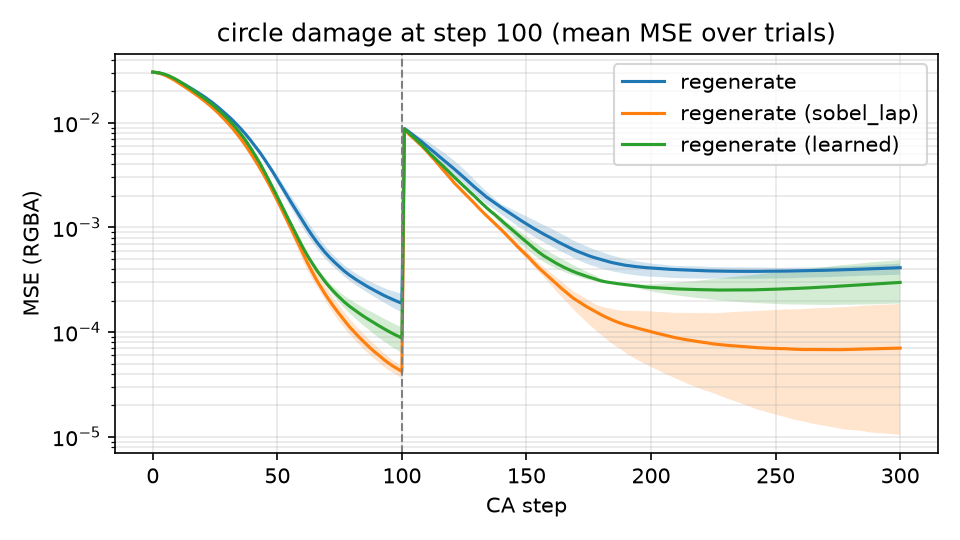

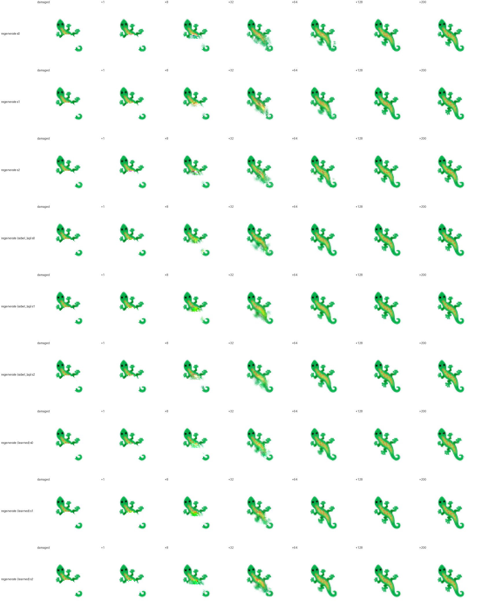

- With three seeds the Laplacian channel is consistently, if modestly, the best perception: pooled
  rates 0.98 [0.95, 1.00], 0.93 [0.80, 1.00] and 1.00 [1.00, 1.00], the fastest repairs (33, 49 and
  12 steps), the best fit (training loss 8.4e-5, MSE 1.2e-5 at step 1000) and, on the dropout, a
  return to the quality of the intact control on every seed (residual ratio 1.01 to 1.05). Seeds 1
  and 2 repair every trial of every damage type; seed 0 (0.95, 0.80, 1.00) accounts for every missed
  trial. On the disc, every Sobel + Laplacian seed (0.95 to 1.00) beats every Sobel seed (0.85 to
  0.90).
- Learned kernels land between the two fixed stages (0.92, 0.97 and 0.98; 34, 56 and 17 steps) and
  repair more slowly than the Laplacian stage: learning the perception does not beat adding one
  well-chosen fixed filter.
- The spread between perceptions (at most 0.10 in pooled rate) stays smaller than the effect of
  the regime or of the update probability. The seed-0 conclusion that the perception matters least
  holds, with the nuance that its small effect is consistent in direction across seeds.

## Caveats

- Three training seeds per condition. The seed-to-seed range of the pooled tables is the relevant
  uncertainty: the 20 trials of one model share its weights, so their spread comes from the
  stochastic update and the damage placement, not from training variance, and one trial moves a
  per-seed rate by 0.05.
- Every model is evaluated with the same evaluation seed: the comparisons are paired (same damage
  positions and masks for every condition) but rest on one draw of 20 placements.
- The absolute threshold (MSE 0.01, a root-mean-square error of 0.1 per RGBA channel) corresponds
  to visible defects; the 1e-3 floor keeps the relative test from penalising near-perfect runs
  whose control is around 1e-5 to 5e-5.
- Damage is applied at step 100 only; the `regenerate` model was trained with discs of radius
  0.1 to 0.4 and is tested at 0.3.

## Next steps

A second target, to check that the ordering of the regimes is not specific to the lizard; more
seeds for the p = 1.0 half cut, whose rate varies from 0.55 to 1.00 between seeds.

## Files

- `results/<run>/`: `config.json`, `summary.json`, `loss.png`, `growth_strip.png` and `eval/`
  (`metrics.json`, `curves.npz`, one curve and one strip per damage type).
- `results/ablation_A_regime/`, `results/ablation_B_fire_rate/`, `results/ablation_C_perception/`:
  `comparison.md` (the seed-0 tables above) and the overlaid figures of each ablation.
- `results/ablation_A_seeds/`, `results/ablation_B_seeds/`, `results/ablation_C_seeds/`: the same
  for the three seeds pooled (tables with ranges, banded curves, strips of every run).
